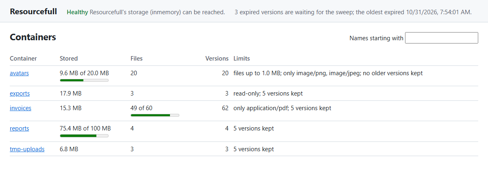
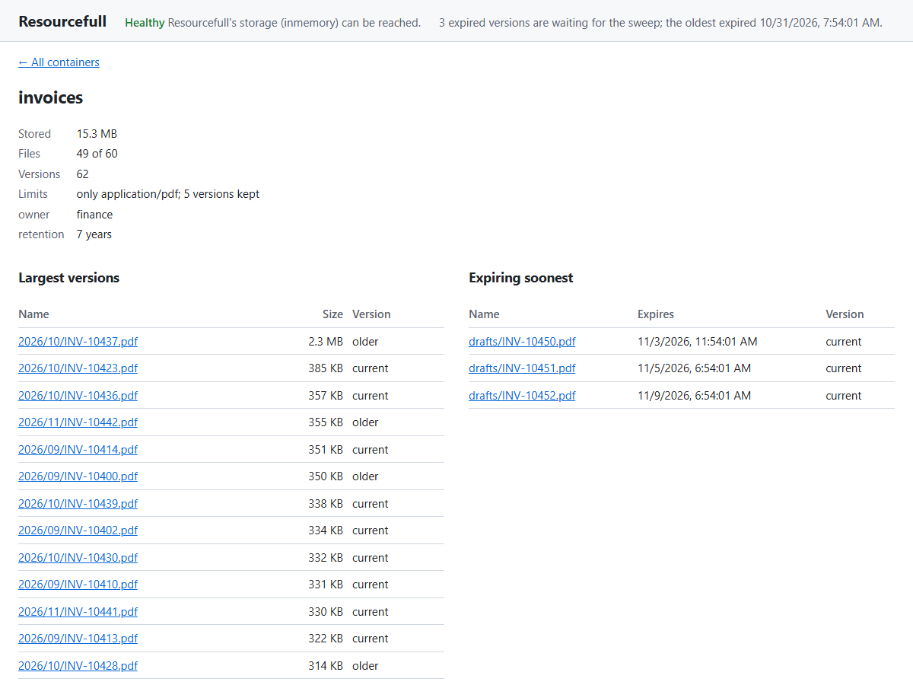
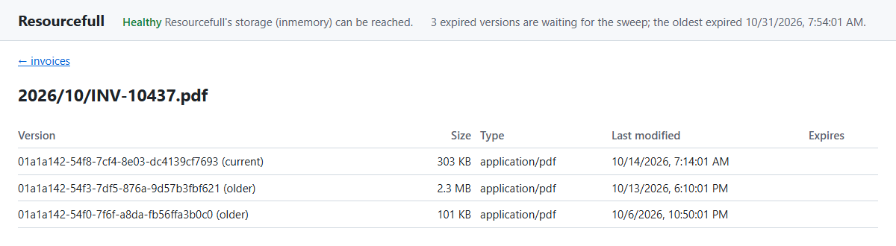
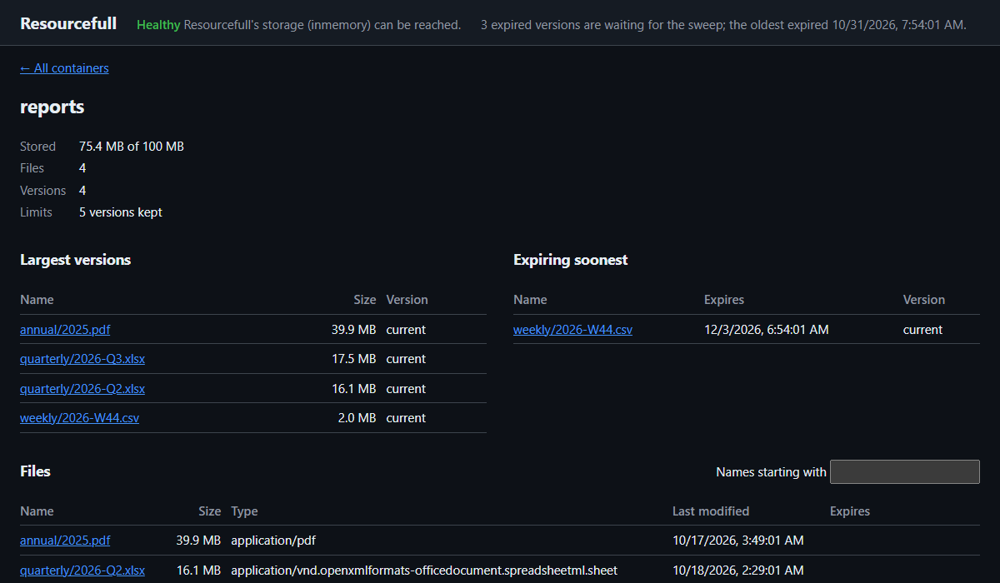

# The dashboard

<div class="rf-version"><span class="rf-badge rf-upcoming">Coming in 4.0</span></div>

`Resourcefull.AspNetCore` includes a small dashboard: a page in your application that shows what's stored. Map it
with one line, much as you'd map Swagger UI, and open it in a browser while you build or support your application.
The dashboard only reads: it can't delete, change or download anything.



## What it shows

Along the top, every view shows:

- **Health:** the result of Resourcefull's [health check](../health-checks.md), including migrations the database is
  missing, or has from a newer release.
- **Expiry:** how many [expired](../expiry.md) versions are waiting for the sweep to delete them, and when the oldest
  of them expired. A count that keeps growing, or an oldest expiry far in the past, means the sweep isn't running or
  isn't keeping up. A [read-only](../container-policies.md) container's expired versions count too, since the sweep
  keeps them until the container is writable again. With a provider that doesn't support expiry, this line is left
  out.

### Containers

The first view lists the containers, 50 at a time, with a filter by the start of their names. For each one, it shows
its stored size against its `MaxContainerSize`, its files against `MaxResourceCount`, how many versions it holds,
and the rest of its [policy](../container-policies.md): whether it's read-only, the types it allows, the largest file
it takes and how many versions it keeps. A bar under a limit shows how close the container is to it.

### One container

Select a container to see its metadata and limits, then two short lists:

- **Largest versions:** its 20 largest versions, current and older alike, since a container's stored size counts
  every version. When a container nears its `MaxContainerSize`, this is what's filling it. An older version that's
  large is often one to delete, or a sign that the container keeps more versions than it needs.
- **Expiring soonest:** the 20 versions that expire first, so you can see what the sweep deletes next before it does.

Below them are its files, 50 at a time, with each one's size, type, last change and expiry.



### One file

Select a file's name, in any of those lists, to see every version of it: the current one first, then the older ones
from the newest, each with its version ID, size, type, last change and expiry.



## Setting it up

```csharp
using Resourcefull.AspNetCore;

builder.Services.AddHealthChecks().AddResourcefullSqlServerCheck();

app.UseAuthentication();
app.UseAuthorization();
app.MapResourcefullDashboard("/resourcefull").RequireAuthorization("admins");
```

Then open `/resourcefull` in a browser. `admins` is an authorization policy you define with `AddAuthorization`, as in
[Securing file endpoints](securing-endpoints.md). Registering the health check is optional; without one, the page
says none is registered.

### Who may see it

The dashboard shows container names, file names and metadata, which can be personal data. So it doesn't run until
you've decided who may see it: until then, every request to it throws `InvalidOperationException`, saying what to add.
Any one of these counts as a decision:

- `RequireAuthorization` on the group `MapResourcefullDashboard` returns, with or without a policy.
- A fallback authorization policy (`AuthorizationOptions.FallbackPolicy`) that covers every endpoint without its own.
- `AllowAnonymous()` on the group, which shows it to anyone who can reach it. Use that only for a tool that runs
  on your own machine, never on a server.

Because `MapResourcefullDashboard` returns the route group, anything else you'd put on endpoints applies to it too,
such as `RequireHost("admin.example.com")` or rate limiting.

### Health checks

The dashboard runs the health checks named `resourcefull`, the name Resourcefull's checks get unless you give them
another. If you registered yours under other names, say which:

```csharp
app.MapResourcefullDashboard("/resourcefull", new ResourcefullDashboardOptions
{
    HealthChecks = ["files-db", "archive-db"]
}).RequireAuthorization("admins");
```

## What it costs

Each page of containers shows up to 50, and each one's usage is a query of its own (policies are cached), so a page
is up to 50 small queries on top of the listing. Usage adds up the container's versions, so the more versions a
container holds, the longer its query takes.

The largest and expiring lists read every version in the container, since neither order has an index of its own. With
SQL Server and PostgreSQL, each list is one query over the container's version rows, much like its usage, without
reading any content, and the expiry count is one read of the index of versions that expire, the same read the sweep
starts with. With the in-memory and S3 providers, the lists are built by reading the container's versions a page of
names at a time.

The dashboard is built for someone looking now and then, not for a wall display refreshing every few seconds.

## The JSON endpoints

The page reads these endpoints under `{pattern}/api/`, which you can call yourself, as a small admin API, to show the
same data your own way. They answer JSON with camelCase names whatever your application's JSON settings are, and
follow the same authorization as the page.

| Endpoint | Returns |
|---|---|
| `GET api/health` | `status` (`Healthy`, `Degraded` or `Unhealthy`, or `null` when no check is registered) and `checks`: each one's `name`, `status`, `description` and `data`. |
| `GET api/containers?prefix=&continuationToken=` | `items`: up to 50 containers, and `continuationToken` for the next page, or `null`. |
| `GET api/container?name=` | One container, or 404 when it doesn't exist. |
| `GET api/resources?container=&prefix=&continuationToken=` | `items`: up to 50 of the container's current files, and `continuationToken`; 404 when the container doesn't exist. |
| `GET api/largest?container=` | `items`: the container's 20 largest versions, current and older, largest first; 404 when the container doesn't exist. |
| `GET api/expiring?container=` | `items`: the container's 20 versions that expire soonest, soonest first, leaving out versions without an expiry; 404 when the container doesn't exist. |
| `GET api/versions?container=&name=` | `items`: every version of one file, the current one first; 404 when the file or the container doesn't exist. |
| `GET api/expired` | `supported`: whether the provider supports expiry; `count`: how many expired versions are waiting for the sweep, counting up to 100; `more`: whether there are more than that; and `oldestExpiry`: when the first of them expired, or `null` when none are waiting. |

A container holds `name`, `metadata`, `usage` and `policy`. `usage` holds `storedSize` in bytes, `resourceCount` and
`versionCount`. `policy` holds `maxResourceSize` and `maxContainerSize` in bytes, `maxResourceCount` and
`allowedContentTypes`, each `null` when there's no limit, plus `readOnly` and `maxVersions`, the versions kept per
name. A file or version holds `name`, `versionId`, `isLatest` (whether it's the current version), `contentType`,
`contentLength`, `lastModified` and `expiresAt`.

A malformed continuation token, a token from a listing with a different `prefix`, or a container or file name the
[name rules](../names.md) refuse gets 400 Bad Request.

Names go in the query string rather than the path, because container and file names can hold `/`.

To list versions by size or expiry in your own code, rather than over HTTP, call `GetTopVersionsAsync` on a container
client, and `GetExpiredVersionsAsync` on the service client; the dashboard's lists come from those.

## The page

The page is three files, `{pattern}/`, `dashboard.js` and `dashboard.css`, served from the package. It loads nothing
from other sites and has no inline script, so a Content Security Policy of `default-src 'self'` doesn't block it.
Opening `{pattern}` without the slash redirects to it, since the page finds its files relative to that.

It follows the browser's light or dark setting:



## Telemetry

Each request to the dashboard gets `resourcefull.dashboard` on its span, naming what it asked for: `page`, `health`,
`expired`, `containers`, `container`, `resources`, `largest`, `expiring` or `versions`. The reads behind it record
their usual operations, such as `list_containers`, `get_usage`, `list_page`, `list_top`, `list_versions` and
`list_expired`. For activity over time (uploads, downloads, errors), use the
[metrics](../telemetry.md) rather than the dashboard, which only shows the current state.
