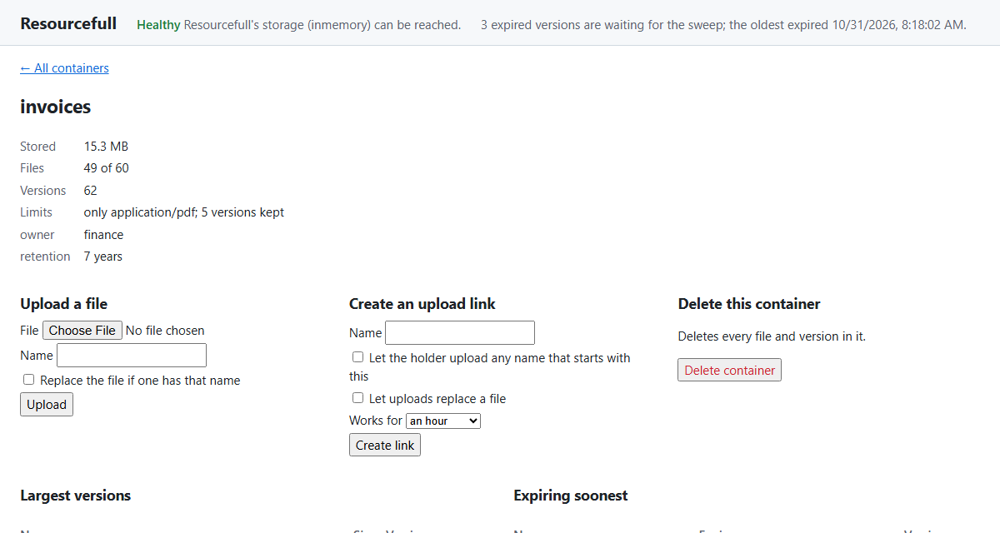
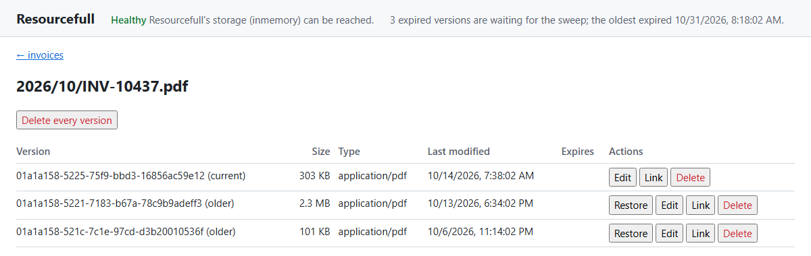

# The dashboard

<div class="rf-version"><span class="rf-badge rf-upcoming">Coming in 4.0</span></div>

`Resourcefull.AspNetCore` includes a small dashboard: a page in your application that shows what's stored. Map it
with one line, much as you'd map Swagger UI, and open it in a browser while you build or support your application.
By default it only reads. While you develop, you can also let it upload, delete and change files, as described in
[Making changes](#making-changes).


## What it shows

Along the top, every view shows:

- **Health:** the result of Resourcefull's [health check](../health-checks.md), including migrations the database is
  missing, or has from a newer release.
- **Expiry:** how many [expired](../expiry.md) versions are waiting for the sweep to delete them, and when the oldest
  of them expired. A count that keeps growing, or an oldest expiry far in the past, means the sweep isn't running or
  isn't keeping up. A [read-only](../container-policies.md) container's expired versions count too, since the sweep
  keeps them until the container is writable again. With a provider that doesn't support expiry, this line is left
  out.

### Containers

The first view lists the containers, 50 at a time, with a filter by the start of their names. For each one, it shows
its stored size against its `MaxContainerSize`, its files against `MaxResourceCount`, how many versions it holds,
and the rest of its [policy](../container-policies.md): whether it's read-only, the types it allows, the largest file
it takes and how many versions it keeps. A bar under a limit shows how close the container is to it.

### One container

Select a container to see its metadata and limits, then two short lists:

- **Largest versions:** its 20 largest versions, current and older alike, since a container's stored size counts
  every version. When a container nears its `MaxContainerSize`, this is what's filling it. An older version that's
  large is often one to delete, or a sign that the container keeps more versions than it needs.
- **Expiring soonest:** the 20 versions that expire first, so you can see what the sweep deletes next before it does.

Below them are its files, 50 at a time, with each one's size, type, last change and expiry.


### One file

Select a file's name, in any of those lists, to see every version of it: the current one first, then the older ones
from the newest, each with its version ID, size, type, last change and expiry.


## Setting it up

```csharp
using Resourcefull.AspNetCore;

builder.Services.AddHealthChecks().AddResourcefullSqlServerCheck();

app.UseAuthentication();
app.UseAuthorization();
app.MapResourcefullDashboard("/resourcefull").RequireAuthorization("admins");
```

Then open `/resourcefull` in a browser. `admins` is an authorization policy you define with `AddAuthorization`, as in
[Securing file endpoints](securing-endpoints.md). Registering the health check is optional; without one, the page
says none is registered.

### Who may see it

The dashboard shows container names, file names and metadata, which can be personal data. So it doesn't run until
you've decided who may see it: until then, every request to it throws `InvalidOperationException`, saying what to add.
Any one of these counts as a decision:

- `RequireAuthorization` on the group `MapResourcefullDashboard` returns, with or without a policy.
- A fallback authorization policy (`AuthorizationOptions.FallbackPolicy`) that covers every endpoint without its own.
- `AllowAnonymous()` on the group, which shows it to anyone who can reach it. Use that only for a tool that runs
  on your own machine, never on a server.

Because `MapResourcefullDashboard` returns the route group, anything else you'd put on endpoints applies to it too,
such as `RequireHost("admin.example.com")` or rate limiting.

### Health checks

The dashboard runs the health checks named `resourcefull`, the name Resourcefull's checks get unless you give them
another. If you registered yours under other names, say which:

```csharp
app.MapResourcefullDashboard("/resourcefull", new ResourcefullDashboardOptions
{
    HealthChecks = ["files-db", "archive-db"]
}).RequireAuthorization("admins");
```

## Making changes

> [!WARNING]
> **Changes aren't ready for production as they are.** They're meant for development, much as Swagger UI is: a quick
> way to try things against your own data. Before you turn them on anywhere else, see
> [Before you use changes beyond development](#before-you-use-changes-beyond-development).

With `AllowChanges`, the dashboard can change what's stored:

```csharp
if (app.Environment.IsDevelopment())
{
    app.MapResourcefullDashboard("/resourcefull", new ResourcefullDashboardOptions { AllowChanges = true })
        .AllowAnonymous();
}
else
{
    app.MapResourcefullDashboard("/resourcefull").RequireAuthorization("admins");
}
```

It then adds:

- **On the list of containers:** a form to create a container.
- **On a container:** a form to upload a file under its own name or one you give it, replacing any file with that
  name if you check the box. There's also a button that deletes the container and everything in it, once you type
  its name to confirm.
- **On a file's versions:** buttons for each version to restore an older version as the current one, edit its content
  type, expiry and metadata, or delete it, and one to delete every version of the file.





Each change goes through the same client methods your code uses, so the container's [policy](../container-policies.md)
applies to it as it would to your code: a read-only container refuses changes, and an upload must fit the
container's limits and allowed types. When the store refuses a change, the page says why.

### Links

If your application serves [download links](../sharing-links.md) or [upload links](../upload-links.md), the dashboard
can create them too. Tell it the path of each endpoint, with `{token}` where the token goes, and register the link
signer with `AddResourcefullLinks`:

```csharp
builder.Services.AddResourcefullLinks();

app.MapResourcefullDashboard("/resourcefull", new ResourcefullDashboardOptions
{
    AllowChanges = true,
    DownloadLinkPath = "/shared/{token}",
    UploadLinkPath = "/upload/{token}"
}).AllowAnonymous();
```

Each version then gets a **Link** button, which creates a download link to that version that works for an hour. A
container gets a form to create an upload link that works for an hour, a day or seven days, either for one name or for
any name that starts with what you type. The dashboard shows the link to copy. Leave either path out, and the dashboard
doesn't offer that kind of link.

### How the dashboard protects changes

- **They're off by default.** Mapping the dashboard without `AllowChanges` maps no endpoint that changes anything.
- **Anyone who can open the dashboard can change things.** Changes follow the same authorization as the rest of the
  dashboard, so with `AllowChanges`, everyone it lets in can delete files.
- **Another site can't make them.** If you're signed in to your application, another site's page could make your
  browser send a request to the dashboard's change endpoints, with your cookies attached. The dashboard's page
  sends a header of its own with every change, `X-Resourcefull-Dashboard`, and the change endpoints refuse a request
  without it. A browser sends a header like that to another site only if that site agrees, and the dashboard never
  does. A request whose browser reports, in `Sec-Fetch-Site`, that it came from anywhere but the dashboard's own origin
  is refused too. Each refusal is logged as a warning, under the same category as the changes.
- **Each change is logged.** The dashboard logs every change it makes at `Information`, under the category
  `Resourcefull.AspNetCore.Dashboard`, with the user's name, the action, and the container, file and version, so you
  have a record of who did what.

### Before you use changes beyond development

The dashboard's page is the same wherever it runs, so what keeps changes safe is how you map it. Before you turn on
`AllowChanges` on a shared or production server:

- **Require a policy only administrators meet,** such as `RequireAuthorization("admins")`, rather than any signed-in
  user. Or map a read-only dashboard for most people and one with changes, at another path, for administrators.
- **Keep it off the public internet,** for example with `RequireHost("admin.internal.example.com")` or a network rule,
  so the change endpoints can't be reached from outside.
- **Keep the logs.** Send the `Resourcefull.AspNetCore.Dashboard` category somewhere they're kept, if the log is your
  record of who changed what.
- **Think about CORS.** If your application allows cross-origin requests with credentials from other sites, those
  sites can send the dashboard's header. Don't apply such a policy to the dashboard's endpoints.

## What it costs

Each page of containers shows up to 50, and each one's usage is a query of its own (policies are cached), so a page
is up to 50 small queries on top of the listing. Usage adds up the container's versions, so the more versions a
container holds, the longer its query takes.

The largest and expiring lists read every version in the container, since neither order has an index of its own. With
SQL Server, PostgreSQL and SQLite, each list is one query over the container's version rows, much like its usage,
without reading any content, and the expiry count is one read of the index of versions that expire, the same read the
sweep starts with. With the in-memory and S3 providers, the lists are built by reading the container's versions a page
of names at a time.

The dashboard is built for someone looking now and then, not for a wall display refreshing every few seconds.

## The JSON endpoints

The page reads these endpoints under `{pattern}/api/`, which you can call yourself, as a small admin API, to show the
same data your own way. They answer JSON with camelCase names whatever your application's JSON settings are, and
follow the same authorization as the page.

| Endpoint | Returns |
|---|---|
| `GET api/health` | `status` (`Healthy`, `Degraded` or `Unhealthy`, or `null` when no check is registered) and `checks`: each one's `name`, `status`, `description` and `data`. |
| `GET api/containers?prefix=&continuationToken=` | `items`: up to 50 containers, and `continuationToken` for the next page, or `null`. |
| `GET api/container?name=` | One container, or 404 when it doesn't exist. |
| `GET api/resources?container=&prefix=&continuationToken=` | `items`: up to 50 of the container's current files, and `continuationToken`; 404 when the container doesn't exist. |
| `GET api/largest?container=` | `items`: the container's 20 largest versions, current and older, largest first; 404 when the container doesn't exist. |
| `GET api/expiring?container=` | `items`: the container's 20 versions that expire soonest, soonest first, leaving out versions without an expiry; 404 when the container doesn't exist. |
| `GET api/versions?container=&name=` | `items`: every version of one file, the current one first; 404 when the file or the container doesn't exist. |
| `GET api/expired` | `supported`: whether the provider supports expiry; `count`: how many expired versions are waiting for the sweep, counting up to 100; `more`: whether there are more than that; and `oldestExpiry`: when the first of them expired, or `null` when none are waiting. |
| `GET api/features` | `changes`, `downloadLinks` and `uploadLinks`: whether the dashboard was mapped to allow each. |

With `AllowChanges`, these endpoints change what's stored. Each needs the `X-Resourcefull-Dashboard` header, with any
value, and answers 403 Forbidden without it. When the store refuses a change, they answer with the status code and
problem details [the exception handler](status-codes.md) would, such as 409 Conflict for a name that's taken or 403
Forbidden for a read-only container, and 404 Not Found when what they change doesn't exist.

| Endpoint | Does |
|---|---|
| `PUT api/upload?container=&name=&replace=` | Stores the request body as the file, with the request's `Content-Type`; with `replace=true`, as a new version if a file already has that name. Answers 201 Created with the version. |
| `DELETE api/resource?container=&name=&versionId=` | Deletes one version, or with no `versionId`, every version of the file. |
| `POST api/restore?container=&name=&versionId=` | Restores an older version as the current one, and answers with the new version. |
| `PUT api/expiry?container=&name=&versionId=` | Sets the version's expiry from the body's `expiresAt`, or clears it with `null`; with no `versionId`, the current version's. |
| `PUT api/content-type?container=&name=&versionId=` | Sets the version's content type from the body's `contentType`. |
| `PUT api/metadata?container=&name=&versionId=` | Replaces the version's metadata with the body's `metadata`. |
| `POST api/containers` | Creates a container named by the body's `name`. |
| `DELETE api/container?name=` | Deletes the container and everything in it. |
| `POST api/download-link?container=&name=&versionId=` | With `DownloadLinkPath`: creates a download link that works for the body's `expiresInMinutes` (an hour if it's left out, seven days at most), and answers with its `url` and `expiresAt`. |
| `POST api/upload-link?container=` | With `UploadLinkPath`: creates an upload link for the body's `name` or its `namePrefix` (exactly one of them), that works for `expiresInMinutes` (an hour if it's left out, seven days at most), and lets uploads replace a file if `replace` is `true`. Answers with its `url` and `expiresAt`. |

A container holds `name`, `metadata`, `usage` and `policy`. `usage` holds `storedSize` in bytes, `resourceCount` and
`versionCount`. `policy` holds `maxResourceSize` and `maxContainerSize` in bytes, `maxResourceCount` and
`allowedContentTypes`, each `null` when there's no limit, plus `readOnly` and `maxVersions`, the versions kept per
name. A file or version holds `name`, `versionId`, `isLatest` (whether it's the current version), `contentType`,
`contentLength`, `lastModified`, `expiresAt` and `metadata`.

A malformed continuation token, a token from a listing with a different `prefix`, or a container or file name the
[name rules](../names.md) refuse gets 400 Bad Request.

Names go in the query string rather than the path, because container and file names can hold `/`.

To list versions by size or expiry in your own code, rather than over HTTP, call `GetTopVersionsAsync` on a container
client, and `GetExpiredVersionsAsync` on the service client; the dashboard's lists come from those.

## The page

The page is three files, `{pattern}/`, `dashboard.js` and `dashboard.css`, served from the package. It loads nothing
from other sites and has no inline script, so a Content Security Policy of `default-src 'self'` doesn't block it.
Opening `{pattern}` without the slash redirects to it, since the page finds its files relative to that.

It follows the browser's light or dark setting:


## Telemetry

Each request to the dashboard gets `resourcefull.dashboard` on its span, naming what it asked for: `page`,
`features`, `health`, `expired`, `containers`, `container`, `resources`, `largest`, `expiring` or `versions`, and for
changes, `upload`, `delete`, `restore`, `set_expiry`, `set_content_type`, `set_metadata`, `create_container`,
`delete_container`, `download_link` or `upload_link`. The operations behind it record their usual spans, such as
`list_containers`, `get_usage`, `list_page`, `list_top`, `list_versions`, `list_expired`, `upload` and `delete`. For activity over time (uploads, downloads, errors), use the
[metrics](../telemetry.md) rather than the dashboard, which only shows the current state.
